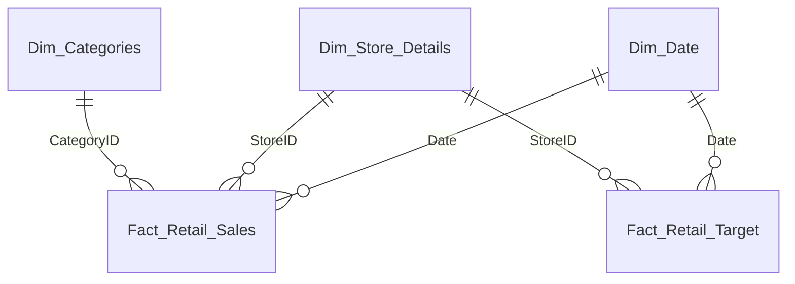
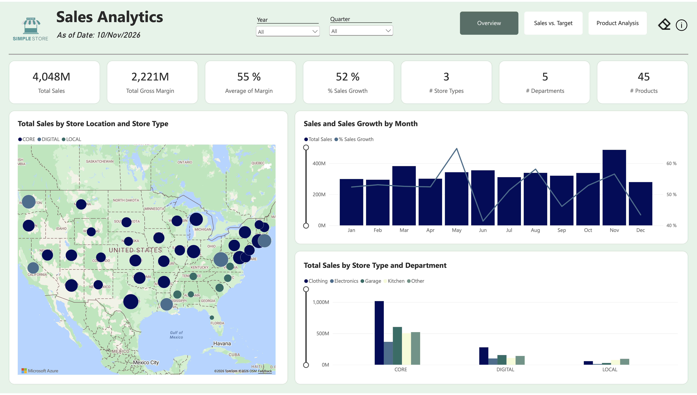
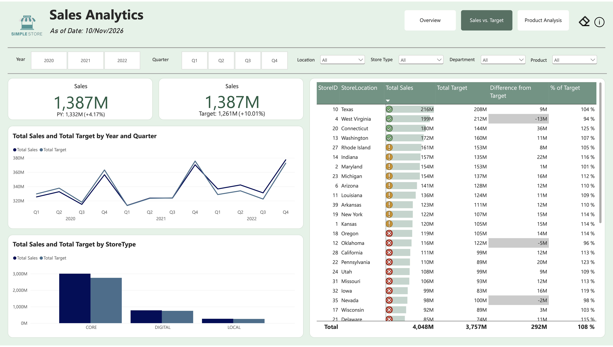
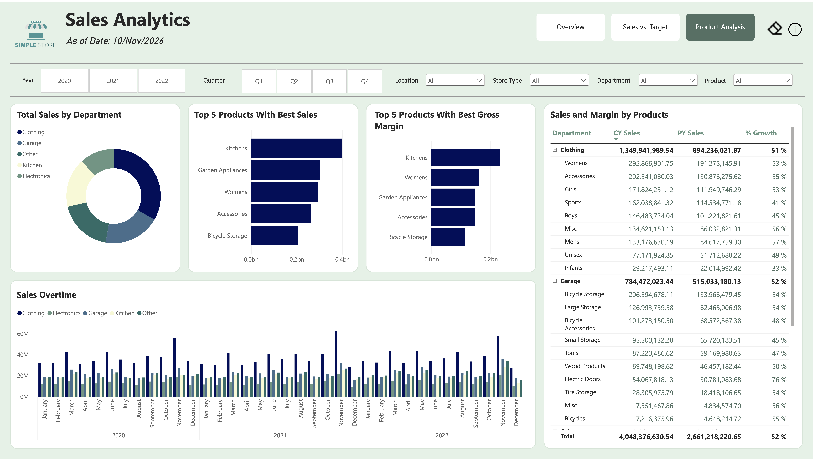

# Sales Performance Dashboard

A three-page Power BI report that tracks sales, progress against targets, and product performance for a fictional retail chain.

## Project Background

Simple Store is a fictional US retail chain with three store types (CORE, DIGITAL, LOCAL), five departments and 45 products, with sales data from 2020 to 2022. This project builds a dashboard the business can use to track its KPIs, check sales against targets and see which stores and products drive results.

It is designed for sales leadership, store and regional managers, merchandising and category managers, and finance and planning teams. I built it as a portfolio project, acting as the business analyst.

## Business Questions

1. **Where do sales and gross margin come from?** By store type, location and department *(Sales Overview)*
2. **When does demand peak?** Monthly sales patterns and seasonality *(Sales Overview)*
3. **Are we meeting sales targets, and which stores fall short?** This year versus the prior year and target, over time, by store type and by state *(Sales vs. Target)*
4. **Which departments and products lead in sales, gross margin and growth?** *(Product Analysis)*

## Dataset Description

The data is fictional and covers **2020–2022**. It comes from four files:

| File | Contents |
|---|---|
| Store Details (CSV) | Store ID, location, store type, store size |
| Sales Retail 2020–2022 (CSV) | Weekly sales and margin rate by store and product category |
| Retail Target (Excel) | Target sales, rent and wages by store and date |
| Department List (Excel) | Category ID mapped to department and group |

**Data cleaning (Power Query):**
- **Store details:** filled missing store types, split the location text into a clean state name, merged in store size, removed StoreID 99 and set data types.
- **Sales:** removed header rows and blank stores, unpivoted the date columns into rows, converted text to dates, removed error rows, pivoted sales and margin back into columns and set data types.
- **Targets and categories:** loaded from Excel and set data types.
- **Gross Margin:** calculated as `Sales × Margin`.

## Data Architecture

The model is a star schema: two fact tables (sales and targets) share the date and store dimensions, so sales and targets can be compared by month, quarter, year, store and location.

**Key DAX measures** (kept in a dedicated `_Measures` table):

| Measure | Why it is needed |
|---|---|
| `% of Target` | Compares sales with target for any store, period or product |
| `Difference from Target` | Shows the surplus or shortfall in sales terms |
| `% Sales Growth` | Compares sales with the prior-year equivalent |
| `As of Date` | Shows the report date in the page header |

## Approach

1. **Define the questions:** decide the KPIs and business questions the report should answer.
2. **Prepare the data:** import the four source files and clean them in Power Query.
3. **Build the data model:** create a star schema with a date dimension and the relationships above.
4. **Create DAX measures:** add the target, difference, growth and date measures.
5. **Build the report pages:** create Sales Overview, Sales vs. Target and Product Analysis with slicers and cross-filtering.
6. **Polish the user experience:** add navigation buttons, tooltips, a reset button, page titles, a theme and an information button.
7. **Interpret the results:** document the findings and recommendations.

## Analysis & Insights

Full details are in [dashboard-insights.md](dashboard-insights.md). Values read from charts are approximate.

### 1. Where do sales and gross margin come from?

- Total sales are **4,048M** with **2,221M** gross margin (about **55%** of sales).
- **CORE stores generate about 74% of sales** (about 3,000M), and **Clothing is the largest department**, with about one-third of total sales.

### 2. When does demand peak?

- **November is the strongest month**, with about 490M across the three years, roughly 45% above the average month. March is second.
- The Product Analysis page shows Clothing peaking in November in every year, so the pattern is consistent, and March is also consistently high.

### 3. Are we meeting sales targets, and which stores fall short?

- This year (2022), sales are **1,387M**: **+4.17%** versus the prior year (1,332M) and **+10.01%** versus the 1,261M target.
- The quarterly chart shows sales below target in 2020, close to target in 2021 and above target in all four quarters of 2022.
- Among the visible states, only **West Virginia (94%), Oklahoma (96%) and Nevada (98%)** fall short of target.
- West Virginia has the highest target on screen (212M) while ranking second on sales, so its target may be worth reviewing as well as its performance.

### 4. Which departments and products lead?

- **Clothing is the leading department**, with about 1,350M in sales, led by Womens (293M) and Accessories (203M).
- **Kitchens are the top product** on both sales (about 400M) and gross margin (about 230M), and Womens ranks third on sales but second on gross margin.

## Conclusion

Simple Store beat its overall sales target by 8%, with CORE stores and Clothing doing most of the work and November the clear peak. Annual sales were flat in 2020–2021 and grew 4.17% in 2022, finishing 10% above that year's target. A few states, led by West Virginia, miss their targets, and some products earn a different margin than their sales rank suggests.

**Recommendations:**
- Plan inventory and staffing ahead of November and March, prioritising Clothing and Kitchens.
- Review West Virginia, Oklahoma and Nevada to see whether the gap comes from demand, stock or target setting.
- Look at margin as well as sales before directing resources, starting with Kitchens and Womens.

**Limitations:** the data is fictional and has no pricing, promotion, inventory or customer detail, so the findings describe patterns rather than causes. Some figures are read from charts and are approximate.

## Tech Stack

**Tools:** Power BI Desktop, Power Query, DAX \
**Data formats:** CSV, Excel (.xlsx) \
**Modeling:** Star schema
